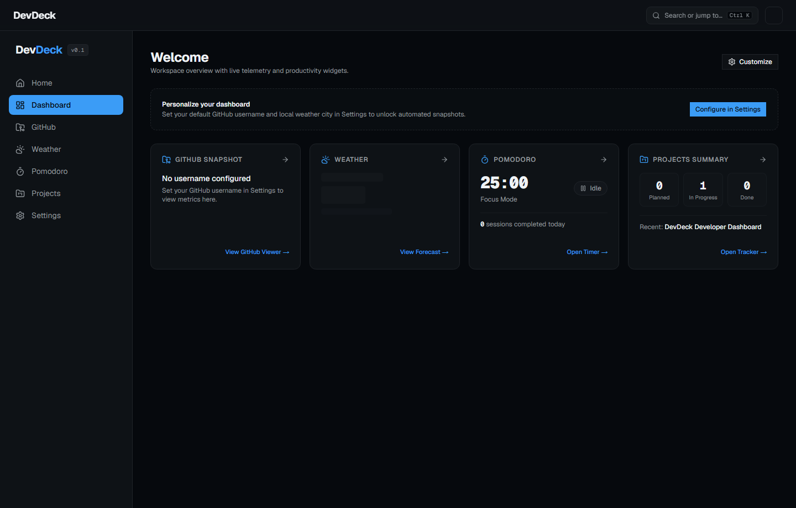
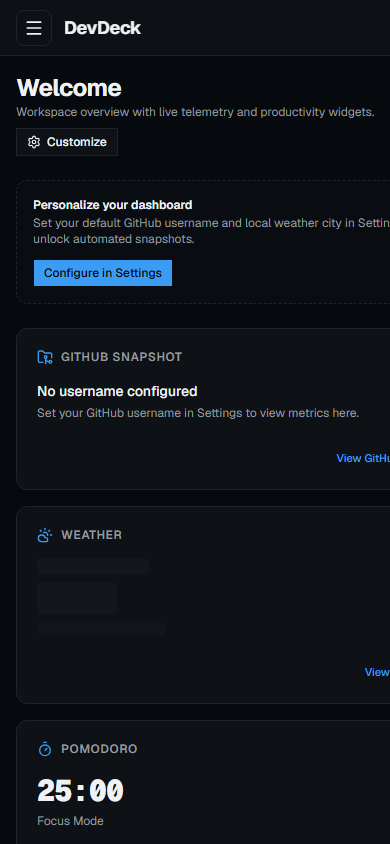

# DevDeck

> A fast, modular developer dashboard built with Next.js 16, TypeScript, and Tailwind CSS v4.

<!-- TODO: Update with your deployed Vercel production URL if different -->
**Live Demo:** [dev-deck-kappa.vercel.app](dev-deck-kappa.vercel.app)

---

## Preview

### Desktop (Dark & Light)


### Mobile


---

## Overview

DevDeck is a personal developer productivity hub designed to bring essential daily tools into a unified, zero-distraction workspace:
- **GitHub Telemetry:** Inspect user profiles, filter and sort public repositories, examine language distributions, and monitor live contribution events.
- **Atmospheric Weather:** Real-time conditions, 12-hour hourly trends, and 5-day forecasts via Open-Meteo, with city search and browser geolocation.
- **Drift-Free Pomodoro:** Focus interval timer engineered with absolute timestamps (`Date.now()`) to maintain second-accuracy across background tabs, paired with a 7-day productivity history chart.
- **Projects Tracker:** Three-column Kanban task board with HTML5 drag-and-drop, keyboard and touch action menus, and JSON import/export.
- **Unified Settings:** Global light/dark/system theming, persistent user defaults, and a one-click local storage purge.
- **Command Palette (`Ctrl+K`):** Fast keyboard navigation to jump across pages and run immediate GitHub profile lookups.

DevDeck runs entirely on the frontend with zero external database dependencies. All telemetry and preferences persist locally in your browser.

---

## Lighthouse Verification

Audited against Next.js production build:

| Metric | Score |
| :--- | :--- |
| **Performance** | **99** |
| **Accessibility** | **100** |
| **Best Practices** | **100** |
| **SEO** | **100** |

---

## Architecture & Design Decisions

### 1. Next.js Route Handlers as Proxy
GitHub's public REST API enforces a strict rate limit of 60 requests per hour for unauthenticated clients. DevDeck routes GitHub requests through `/api/github/[...path]` route handlers. This architecture:
- Keeps personal access tokens secure on the server (`GITHUB_TOKEN` is never leaked to the client bundle).
- Automatically increases rate limits to 5,000 requests per hour when a token is configured.
- Implements 60-second caching via Next.js fetch revalidation to reduce redundant network roundtrips.
- Gracefully handles 403 and 404 responses with user-facing status indicators and remaining-quota countdowns.

### 2. Timestamp-Synchronized Pomodoro Timer
Traditional `setInterval` counters drift rapidly when browser tabs are hidden, throttled, or suspended by operating system power-management heuristics. DevDeck computes all timer progress from fixed target timestamps (`endTimestamp - Date.now()`). When switching tabs or waking a machine from sleep, the countdown remains synchronized to the millisecond.

### 3. Typed Storage Helper & Synchronized Store
Rather than scattering raw `localStorage.getItem` calls across components, DevDeck centralizes local persistence in `lib/storage.ts` and `lib/settings.ts`. Built on React 19's `useSyncExternalStore`, settings are completely safe against SSR hydration mismatches and automatically synchronize state across disparate views without prop drilling.

### 4. Zero Charting Dependencies
Rather than importing heavy charting bundles (e.g., Chart.js, Recharts) that add tens of kilobytes of JavaScript overhead, all charts in DevDeck—including the GitHub language distribution bar and the 7-day Pomodoro activity graph—are hand-coded using clean semantic SVG and responsive CSS flex layouts.

---

## Tech Stack

- **Framework:** [Next.js 16 (App Router)](https://nextjs.org/)
- **Library:** [React 19](https://react.dev/)
- **Language:** [TypeScript](https://www.typescriptlang.org/) (Strict mode, zero `any`)
- **Styling:** [Tailwind CSS v4](https://tailwindcss.com/)
- **UI Primitives:** [@base-ui/react](https://base-ui.com/), [shadcn/ui](https://ui.shadcn.com/)
- **Icons:** [Lucide React](https://lucide.dev/)
- **Theming:** [next-themes](https://github.com/pacocoursey/next-themes)
- **Telemetry APIs:** GitHub REST API, [Open-Meteo](https://open-meteo.com/) (Geocoding & Weather Forecasts)

---

## Project Structure

```
├── app/
│   ├── api/github/[...path]/ # GitHub proxy route handler
│   ├── dashboard/            # Overview widgets
│   ├── github/               # Profile, repository, language & event viewer
│   ├── weather/              # Real-time weather & 5-day forecast
│   ├── pomodoro/             # Background-accurate focus timer
│   ├── projects/             # Kanban board
│   ├── settings/             # User preferences & data reset
│   ├── globals.css           # Restrained design system & OKLCH variables
│   └── layout.tsx            # App shell, fonts, theme provider
├── components/
│   ├── dashboard/            # Live widget cards
│   ├── github/               # Repositories list, language bar, event list
│   ├── pomodoro/             # 7-day SVG chart, timer controls
│   ├── projects/             # Project cards, modal dialogs
│   ├── weather/              # Current conditions, hourly strip, 5-day cards
│   ├── ui/                   # Buttons, sheets, search bars, modals
│   ├── CommandPalette.tsx    # Ctrl+K modal palette
│   ├── Navbar.tsx            # Top application header
│   └── Sidebar.tsx           # Responsive navigation drawer
├── constants/
│   ├── routes.ts             # Route definitions
│   └── weather.ts            # WMO code-to-icon mapping
├── lib/
│   ├── audio.ts              # Web Audio API synthesiser & notifications
│   ├── settings.ts           # useSettings hook & defaults
│   ├── storage.ts            # Typed localStorage abstraction
│   └── utils.ts              # Class merging utilities
├── services/
│   ├── github.service.ts     # GitHub API proxy client
│   └── weather.service.ts    # Open-Meteo geocoding & forecast client
└── types/                    # Strict TypeScript definitions
```

---

## Getting Started

### Prerequisites
- Node.js 20.x or higher
- npm 10.x or higher

### Installation

1. Clone the repository:
   ```bash
   git clone https://github.com/ashutosh-tanguria/DevDeck---FE-only.git
   cd DevDeck---FE-only
   ```

2. Install dependencies:
   ```bash
   npm install
   ```

3. (Optional) Configure environment variables:
   Copy `.env.example` to `.env.local` and add your GitHub token if you wish to raise rate limits:
   ```bash
   cp .env.example .env.local
   ```
   ```env
   GITHUB_TOKEN=your_personal_access_token_here
   ```

4. Start development server:
   ```bash
   npm run dev
   ```
   Open [http://localhost:3000](http://localhost:3000) in your browser.

5. Build for production:
   ```bash
   npm run build
   npm run start
   ```

---

## Deployment (Vercel)

DevDeck is fully configured for zero-configuration deployment on [Vercel](https://vercel.com/):

1. Import your Git repository into Vercel.
2. Under **Environment Variables**, add:
   - `GITHUB_TOKEN`: *(Optional)* Your GitHub Personal Access Token.
3. Click **Deploy**.

---

## Author

- **Ashutosh Tanguria**
- **GitHub:** [https://github.com/ashutosh-tanguria](https://github.com/ashutosh-tanguria)
- **LinkedIn:** [https://www.linkedin.com/in/ashutosh-tanguria/](https://www.linkedin.com/in/ashutosh-tanguria/) <!-- TODO: Update with your LinkedIn profile link -->
